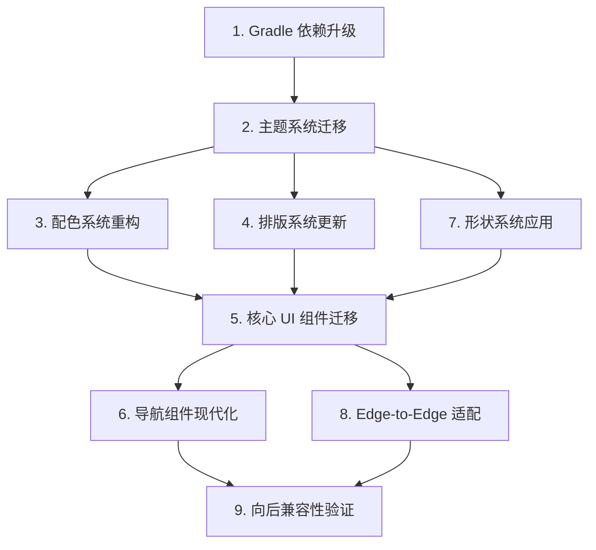

# 设计文档：Material Design 3 迁移

## 概述

本设计文档描述将 DroidDemo 项目从 AppCompat / Material Design 1 迁移至 Material Design 3（Material You）的技术方案。迁移涉及 Gradle 依赖升级、主题系统重构、配色与排版系统更新、核心 UI 组件替换、导航模式现代化（ViewPager → ViewPager2）、形状系统应用、Edge-to-Edge 显示适配，以及向后兼容性保障。

项目当前状态：
- 使用 `Theme.AppCompat.DayNight` 系列主题
- 配色基于旧的 `colorPrimary` / `colorPrimaryDark` / `colorAccent` 三色模型
- 导航使用 `ViewPager` + `FragmentPagerAdapter` + `BottomNavigationView`（已弃用的 `setOnNavigationItemSelectedListener`）
- `compileSdk 36`，`minSdkVersion 34`，`material:1.13.0` 已引入但未启用 MD3 主题

迁移目标是在不破坏现有功能的前提下，全面采用 Material Design 3 的设计语言和组件体系。

## 架构

迁移采用分层递进策略，按依赖关系从底层到上层逐步推进：



### 迁移层次

1. **基础层**：Gradle 依赖确保 Material 库版本支持 MD3
2. **主题层**：主题父类切换 + 色彩角色定义 + 排版样式定义 + 形状属性定义
3. **组件层**：逐个替换 UI 组件为 MD3 对应组件
4. **导航层**：ViewPager → ViewPager2，FragmentPagerAdapter → FragmentStateAdapter
5. **显示层**：Edge-to-Edge 全屏适配
6. **验证层**：编译验证 + 功能回归 + 兼容性测试

### 设计决策

| 决策 | 选择 | 理由 |
|------|------|------|
| 主题切换方式 | 直接替换父主题 | `minSdk 34` 无需考虑低版本兼容，可直接使用 `Theme.Material3.*` |
| Dynamic Color | 在 `ApplicationExt.onCreate()` 中通过 `DynamicColors.applyToActivitiesIfAvailable()` 启用 | 全局生效，无需逐个 Activity 配置 |
| ViewPager2 适配器 | `FragmentStateAdapter` 基于 `FragmentActivity` | 替代已弃用的 `FragmentPagerAdapter`，生命周期管理更优 |
| 第三方库兼容 | 替换为现代 MD3 兼容组件 | `ViewPagerIndicator`、`SlidingMenu`、`PagerSlidingTabStrip` 与 MD3 主题不兼容，使用 Material 官方组件替代更可靠、可维护 |


## 组件与接口

### 1. Gradle 构建配置（`app/build.gradle`）

**变更内容**：
- 移除 `androidx.legacy:legacy-support-v4:1.0.0`
- 添加 `androidx.viewpager2:viewpager2` 依赖（用于 ViewPager2）
- `com.google.android.material:material:1.13.0` 已满足 MD3 要求，无需升级版本

### 2. 主题系统（`res/values/styles.xml`）

**当前状态**：
```xml
<style name="AppTheme.NoActionBar" parent="Theme.AppCompat.DayNight.NoActionBar"/>
<style name="AppTheme.ActionBar" parent="Theme.AppCompat.DayNight"/>
<style name="TvTheme" parent="Theme.AppCompat.NoActionBar"/>
```

**迁移后**：
```xml
<style name="AppTheme.NoActionBar" parent="Theme.Material3.DayNight.NoActionBar">
    <!-- MD3 色彩角色 -->
    <item name="colorPrimary">@color/md3_primary</item>
    <item name="colorOnPrimary">@color/md3_on_primary</item>
    <item name="colorPrimaryContainer">@color/md3_primary_container</item>
    <!-- ... 完整色彩角色定义 -->
</style>

<style name="AppTheme.ActionBar" parent="Theme.Material3.DayNight">
    <!-- 同上色彩角色 -->
</style>

<style name="TvTheme" parent="Theme.Material3.DayNight.NoActionBar">
    <!-- 保留 TV 特有属性，更新色彩引用 -->
</style>
```

### 3. Dynamic Color 启用（`ApplicationExt.java`）

```java
@Override
public void onCreate() {
    super.onCreate();
    DynamicColors.applyToActivitiesIfAvailable(this);
    // ... 现有初始化代码
}
```

### 4. 配色系统（`res/values/colors.xml`）

**新增 MD3 色彩角色**：
- Primary 组：`md3_primary`、`md3_on_primary`、`md3_primary_container`、`md3_on_primary_container`
- Secondary 组：`md3_secondary`、`md3_on_secondary`、`md3_secondary_container`、`md3_on_secondary_container`
- Tertiary 组：`md3_tertiary`、`md3_on_tertiary`、`md3_tertiary_container`、`md3_on_tertiary_container`
- Error 组：`md3_error`、`md3_on_error`、`md3_error_container`、`md3_on_error_container`
- Surface 组：`md3_surface`、`md3_on_surface`、`md3_surface_variant`、`md3_on_surface_variant`
- Outline 组：`md3_outline`、`md3_outline_variant`

**移除**：`colorPrimaryDark`、`colorAccent`（替换为对应 MD3 角色）

### 5. 排版系统（`res/values/styles.xml` 中新增）

定义 MD3 排版样式覆盖（如需自定义字体），布局中使用 `?attr/textAppearanceBodyLarge` 等引用替代硬编码的 `textSize`。

### 6. 核心 UI 组件迁移映射

| 当前组件 | MD3 组件 | 涉及文件 |
|----------|----------|----------|
| `Button` | `MaterialButton` | `content_main.xml` 等多个布局 |
| `CardView` | `MaterialCardView` | `activity_card_view.xml` |
| `AlertDialog` | `MaterialAlertDialogBuilder` | Java 代码中的对话框构建 |
| `Toolbar` / `ActionBar` | `MaterialToolbar` | 使用 ActionBar 主题的 Activity |
| `EditText` | `TextInputLayout` + `TextInputEditText` | 表单类布局 |
| `Spinner` | `TextInputLayout` + `MaterialAutoCompleteTextView` | `activity_spinner.xml` |
| `Switch` / `CheckBox` | `MaterialSwitch` / `MaterialCheckBox` | 设置类布局 |
| `ViewPagerIndicator` | `TabLayout` + `ViewPager2` + `TabLayoutMediator` | 使用 ViewPagerIndicator 的布局和代码 |
| `PagerSlidingTabStrip` | `TabLayout` + `ViewPager2` + `TabLayoutMediator` | 使用 PagerSlidingTabStrip 的布局和代码 |
| `SlidingMenu` | `DrawerLayout` + `NavigationView` | 使用 SlidingMenu 的 Activity 布局和代码 |

### 7. 导航组件现代化

**MainActivity 变更**：

```
ViewPager → ViewPager2
FragmentPagerAdapter → FragmentStateAdapter
setOnNavigationItemSelectedListener → setOnItemSelectedListener
```

**新增 `MainActivityFragmentStateAdapter.java`**：
```java
public class MainActivityFragmentStateAdapter extends FragmentStateAdapter {
    private final List<Fragment> fragments = new ArrayList<>();

    public MainActivityFragmentStateAdapter(@NonNull FragmentActivity fa) {
        super(fa);
    }

    public void addFragment(Fragment fragment) {
        fragments.add(fragment);
    }

    @NonNull @Override
    public Fragment createFragment(int position) {
        return fragments.get(position);
    }

    @Override
    public int getItemCount() {
        return fragments.size();
    }
}
```

**ViewPager2 与 BottomNavigationView 同步**：
- ViewPager2 注册 `OnPageChangeCallback` 更新 BottomNavigationView 选中项
- BottomNavigationView 的 `setOnItemSelectedListener` 控制 ViewPager2 页面切换

### 8. Edge-to-Edge 适配

在 `MainActivity.onCreate()` 中：
```java
WindowCompat.setDecorFitsSystemWindows(getWindow(), false);
```

当前代码已有 `WindowInsetsCompat` 处理逻辑，需确保：
- `BottomNavigationView` 正确处理导航栏内边距
- 滚动内容不被系统栏遮挡

### 9. 第三方库替换方案

对于与 MD3 主题不兼容的第三方库，采用更现代、官方推荐的 Material 组件进行替换：

| 旧三方库 | 替换方案 | 说明 |
|----------|----------|------|
| `ViewPagerIndicator` | `TabLayout` + `ViewPager2` | Material TabLayout 内置指示器支持，通过 `TabLayoutMediator` 与 ViewPager2 联动 |
| `PagerSlidingTabStrip` | `TabLayout` + `ViewPager2` | 功能完全覆盖，且原生支持 MD3 主题样式 |
| `SlidingMenu` | `DrawerLayout` + `NavigationView` | Material NavigationDrawer 是官方推荐的侧滑菜单方案，完全兼容 MD3 |

**迁移要点**：
- 移除旧三方库的 Gradle 依赖
- 将使用 `ViewPagerIndicator` / `PagerSlidingTabStrip` 的布局替换为 `TabLayout`，并通过 `TabLayoutMediator` 绑定 `ViewPager2`
- 将使用 `SlidingMenu` 的 Activity 布局重构为 `DrawerLayout` 包裹 `NavigationView` 的标准结构
- 更新对应 Java 代码中的初始化和事件监听逻辑


## 数据模型

本次迁移不涉及业务数据模型变更。变更集中在 Android 资源文件和 UI 层：

### 资源文件变更清单

| 文件 | 变更类型 | 说明 |
|------|----------|------|
| `app/build.gradle` | 修改 | 移除 legacy-support-v4，添加 viewpager2，移除 ViewPagerIndicator / SlidingMenu / PagerSlidingTabStrip 依赖 |
| `res/values/styles.xml` | 修改 | 主题父类切换，新增 MD3 色彩角色、形状属性 |
| `res/values/colors.xml` | 修改 | 新增 MD3 色调调色板，移除旧色彩定义 |
| `res/layout/activity_main.xml` | 修改 | ViewPager → ViewPager2 |
| `res/layout/activity_card_view.xml` | 修改 | CardView → MaterialCardView |
| `res/layout/activity_spinner.xml` | 修改 | Spinner → ExposedDropdownMenu |
| `res/layout/content_main.xml` | 修改 | Button → MaterialButton，textSize → textAppearance |
| 多个布局文件 | 修改 | 组件替换、颜色引用更新、排版引用更新 |
| `ApplicationExt.java` | 修改 | 添加 DynamicColors 初始化 |
| `MainActivity.java` | 修改 | ViewPager2 + FragmentStateAdapter + Edge-to-Edge |
| `MainActivityViewPagerAdapter.java` | 替换 | 新建 `MainActivityFragmentStateAdapter.java` |
| 使用 ViewPagerIndicator 的布局文件 | 修改 | 替换为 `TabLayout` + `ViewPager2` |
| 使用 PagerSlidingTabStrip 的布局文件 | 修改 | 替换为 `TabLayout` + `ViewPager2` |
| 使用 SlidingMenu 的 Activity 布局 | 修改 | 重构为 `DrawerLayout` + `NavigationView` |
| 使用旧三方库的 Java 文件 | 修改 | 更新初始化和事件监听逻辑 |

### 形状系统定义

在 `styles.xml` 中新增：
```xml
<style name="ShapeAppearance.App.SmallComponent" parent="ShapeAppearance.Material3.SmallComponent">
    <item name="cornerSize">8dp</item>
</style>
<style name="ShapeAppearance.App.MediumComponent" parent="ShapeAppearance.Material3.MediumComponent">
    <item name="cornerSize">12dp</item>
</style>
<style name="ShapeAppearance.App.LargeComponent" parent="ShapeAppearance.Material3.LargeComponent">
    <item name="cornerSize">16dp</item>
</style>
```

主题中引用：
```xml
<item name="shapeAppearanceSmallComponent">@style/ShapeAppearance.App.SmallComponent</item>
<item name="shapeAppearanceMediumComponent">@style/ShapeAppearance.App.MediumComponent</item>
<item name="shapeAppearanceLargeComponent">@style/ShapeAppearance.App.LargeComponent</item>
```


## 正确性属性

*属性（Property）是指在系统所有合法执行路径中都应成立的特征或行为——本质上是对系统应做之事的形式化陈述。属性是人类可读规格说明与机器可验证正确性保证之间的桥梁。*

### 属性 1：主题完整性

*对于任意* 应用主题（AppTheme.NoActionBar、AppTheme.ActionBar、TvTheme），该主题应定义所有必需的 Material Design 3 色彩角色属性（colorPrimary、colorOnPrimary、colorPrimaryContainer、colorOnPrimaryContainer、colorSecondary、colorOnSecondary、colorSecondaryContainer、colorOnSecondaryContainer、colorTertiary、colorSurface、colorOnSurface、colorSurfaceVariant、colorOutline）以及形状属性（shapeAppearanceSmallComponent、shapeAppearanceMediumComponent、shapeAppearanceLargeComponent）。

**验证需求：2.4, 7.1**

### 属性 2：配色系统完整性

*对于任意* Material Design 3 所需的色彩角色（Primary、OnPrimary、PrimaryContainer、OnPrimaryContainer、Secondary、OnSecondary、SecondaryContainer、OnSecondaryContainer、Tertiary、OnTertiary、TertiaryContainer、OnTertiaryContainer、Error、OnError、ErrorContainer、OnErrorContainer、Surface、OnSurface、SurfaceVariant、OnSurfaceVariant、Outline、OutlineVariant），该色彩角色应在 `colors.xml` 中有对应的颜色资源定义。

**验证需求：3.1, 3.2, 3.3**

### 属性 3：布局文件无旧色彩引用

*对于任意* 项目中的布局 XML 文件，文件内容不应包含对已废弃色彩资源（`colorPrimaryDark`、`colorAccent`）的引用。

**验证需求：3.5**

### 属性 4：排版系统完整性

*对于任意* Material Design 3 所需的排版样式名称（displayLarge、displayMedium、displaySmall、headlineLarge、headlineMedium、headlineSmall、titleLarge、titleMedium、titleSmall、bodyLarge、bodyMedium、bodySmall、labelLarge、labelMedium、labelSmall），该样式应在资源文件中有对应定义或可通过 MD3 主题继承获得。

**验证需求：4.1**

### 属性 5：布局文件无硬编码文字大小

*对于任意* 项目中的布局 XML 文件中的 TextView 或其子类元素，不应使用硬编码的 `android:textSize` 属性，而应通过 `android:textAppearance` 引用 Material Design 3 排版样式。

**验证需求：4.2, 4.3**

### 属性 6：布局组件迁移完整性

*对于任意* 项目中的布局 XML 文件，不应包含以下已废弃组件标签：`<Button`（非 MaterialButton）、`<androidx.cardview.widget.CardView`、`<Spinner`、`<Switch`（非 MaterialSwitch）、`<CheckBox`（非 MaterialCheckBox）、`<EditText`（非 TextInputEditText）。所有此类组件应已替换为对应的 Material Design 3 组件。

**验证需求：5.1, 5.2, 5.5, 5.6, 5.7**

### 属性 7：Java 代码组件迁移完整性

*对于任意* 项目中的 Java 源文件，不应包含 `AlertDialog.Builder` 的直接使用（应使用 `MaterialAlertDialogBuilder`），且布局文件中不应包含 `<androidx.appcompat.widget.Toolbar`（应使用 `MaterialToolbar`）。

**验证需求：5.3, 5.4**

### 属性 8：导航标签与页面同步

*对于任意* 有效的标签页索引（0、1、2），当用户在 BottomNavigationView 中选择该索引对应的标签时，ViewPager2 应显示相同索引的页面；反之，当 ViewPager2 滑动到某页面时，BottomNavigationView 应选中对应的标签。

**验证需求：6.4**

### 属性 9：布局文件无硬编码圆角值

*对于任意* 项目中的布局 XML 文件，不应包含硬编码的 `app:cardCornerRadius` 或 `android:radius` 等圆角属性值，而应通过 Material Design 3 形状系统引用。

**验证需求：7.2**

### 属性 10：第三方库完全替换

*对于任意* 项目中的 Java 源文件和布局 XML 文件，不应包含对已废弃第三方库（`ViewPagerIndicator`、`SlidingMenu`、`PagerSlidingTabStrip`）的导入或组件引用。所有此类用法应已替换为对应的 Material Design 3 兼容组件（`TabLayout` + `ViewPager2`、`DrawerLayout` + `NavigationView`）。

**验证需求：9.4**


## 错误处理

### 编译错误

- **资源引用缺失**：迁移过程中移除旧色彩定义（如 `colorPrimaryDark`）前，必须先更新所有引用该资源的布局文件和 Java 代码
- **主题属性不兼容**：`Theme.Material3.*` 不支持部分 AppCompat 特有属性（如 `colorAccent`），需替换为 MD3 等价属性
- **组件类型不匹配**：Java 代码中的 `findViewById` 返回类型需与新组件类型匹配（如 `ViewPager` → `ViewPager2`）

### 第三方库替换

- **ViewPagerIndicator**：依赖旧版 `ViewPager` 且与 MD3 主题不兼容，替换为 `TabLayout` + `ViewPager2`，通过 `TabLayoutMediator` 实现指示器功能
- **PagerSlidingTabStrip**：依赖旧版 `ViewPager`，替换为 `TabLayout` + `ViewPager2`，功能完全覆盖
- **SlidingMenu**：与 MD3 主题的 Surface 色彩体系冲突，替换为 `DrawerLayout` + `NavigationView`（Material NavigationDrawer），原生支持 MD3 样式

### 运行时错误

- **Dynamic Color 降级**：`DynamicColors.applyToActivitiesIfAvailable()` 在不支持的设备上自动降级为静态主题色，无需额外处理（当前 `minSdk 34` 均支持）
- **Edge-to-Edge 内边距**：未正确处理 `WindowInsetsCompat` 可能导致内容被系统栏遮挡，需为所有根布局设置 insets 监听

## 测试策略

### 双重测试方法

本项目采用单元测试与属性测试相结合的策略：

- **单元测试**：验证具体示例、边界情况和错误条件
- **属性测试**：验证跨所有输入的通用属性

两者互补，共同提供全面的测试覆盖。

### 属性测试配置

- **测试库**：使用 [jqwik](https://jqwik.net/)（JUnit 5 平台上的 Java 属性测试库）
- **每个属性测试最少运行 100 次迭代**
- **每个测试用注释标注对应的设计属性**
- **标注格式**：`Feature: material-design-migration, Property {number}: {property_text}`
- **每个正确性属性由单个属性测试实现**

### 单元测试范围

单元测试聚焦于：
- 构建配置验证（依赖版本、compileSdk、minSdk）
- 主题父类正确性验证
- Dynamic Color 初始化代码存在性验证
- ViewPager2 + FragmentStateAdapter 替换验证
- Edge-to-Edge 代码存在性验证
- 第三方库替换验证（ViewPagerIndicator → TabLayout、SlidingMenu → DrawerLayout + NavigationView、PagerSlidingTabStrip → TabLayout）
- 编译成功验证
- 现有 Instrumented Test 通过验证

### 属性测试范围

属性测试聚焦于：
- 主题完整性（属性 1）：生成随机主题名和属性名组合，验证所有必需属性存在
- 配色系统完整性（属性 2）：生成随机 MD3 色彩角色名，验证 colors.xml 中存在定义
- 布局文件无旧色彩引用（属性 3）：遍历所有布局文件，验证无废弃引用
- 排版系统完整性（属性 4）：生成随机排版样式名，验证定义存在
- 布局文件无硬编码文字大小（属性 5）：遍历所有布局文件中的文本元素
- 布局组件迁移完整性（属性 6）：遍历所有布局文件，验证无废弃组件
- Java 代码组件迁移完整性（属性 7）：遍历所有 Java 文件，验证无废弃 API 使用
- 导航同步（属性 8）：生成随机标签页索引序列，验证双向同步
- 布局文件无硬编码圆角（属性 9）：遍历所有布局文件，验证无硬编码圆角值
- 第三方库完全替换（属性 10）：遍历所有 Java 文件和布局文件，验证无旧三方库（ViewPagerIndicator、SlidingMenu、PagerSlidingTabStrip）的导入或组件引用

